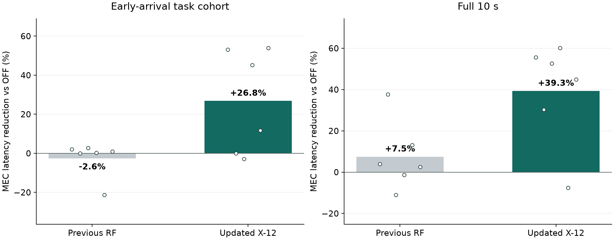

# Chongyu models · 20261124

X-12 MEC latency is the only changed algorithm and weight file. The other five weights are inherited byte for byte from 20261123.

Algorithm: Two-horizon fitted tree ensemble (equal-weight startup and1s contrasts). Controls: downlink scheduling policy and full UE priority maps. Target: mean end-to-end latency of offloaded MEC tasks. Possible side effects: throughput, UE/BS power and URLLC reliability.

The policy was locked before six independent same-origin OFF/ON tests. First application is20.5ms of simulated network time after activation. Startup validation follows tasks born during the first150ms to their real terminal outcomes; this does not assert all finish inside250ms. The strict500-slot online Metric and its missingness remain unchanged. Full validation uses10s plus1s of normal-traffic followup. No network physics, traffic, service capacity or evaluation formula was changed. All raw simulations, including adverse experiments and optimizer checkpoints, remain in the dated ORAN study.

The source archive pin in this release identifies the frozen evaluation snapshot; the runtime recipe separately pins the production harness. P–K coefficients are retained only under independently checked unchanged-physics and fixed-response proofs.

Independent paired latency reduction: 26.84% for the early-arrival cohort; 39.32% over10s. The first250ms deadline-restricted completion cost falls by26.84%.



Reproduce the validated AGX fast/system environment (run from the repository root):

```sh
python scripts/orin/install-trained-xapps.py --bundle artifacts/xapps/chongyu/20261124 --output outputs/trained_xapps/20261124
bash scripts/orin/run-six-ue-cuda-nr.sh --model fast --fast-profile system --slots 24040 --seed 2026112421 --traffic-load 1.5 --ue-services drx-mec --xapp-pool chongyu --live-xapps --xapps-start "" --xapp-model-dir outputs/trained_xapps/20261124 --xapp-toggle-timeline artifacts/xapps/chongyu/20261124/environment/x12-timeline.json --xapp-preview-before-slot 2040 --traffic-profile artifacts/xapps/chongyu/20261124/environment/traffic.json --ue-services-config artifacts/xapps/chongyu/20261124/environment/ue-services.json --ap-services-profile artifacts/xapps/chongyu/20261124/environment/ap-services.json --config artifacts/xapps/chongyu/20261124/environment/base.json --record-compression gzip --output outputs/x12-mec-20261124-reproduction
```

The24040slots include1.02s of native prefix,10s of observation and1s of normal-traffic followup. Choose a fresh output directory for each run. For OFF, omit the toggle timeline and retain the remaining configuration.
