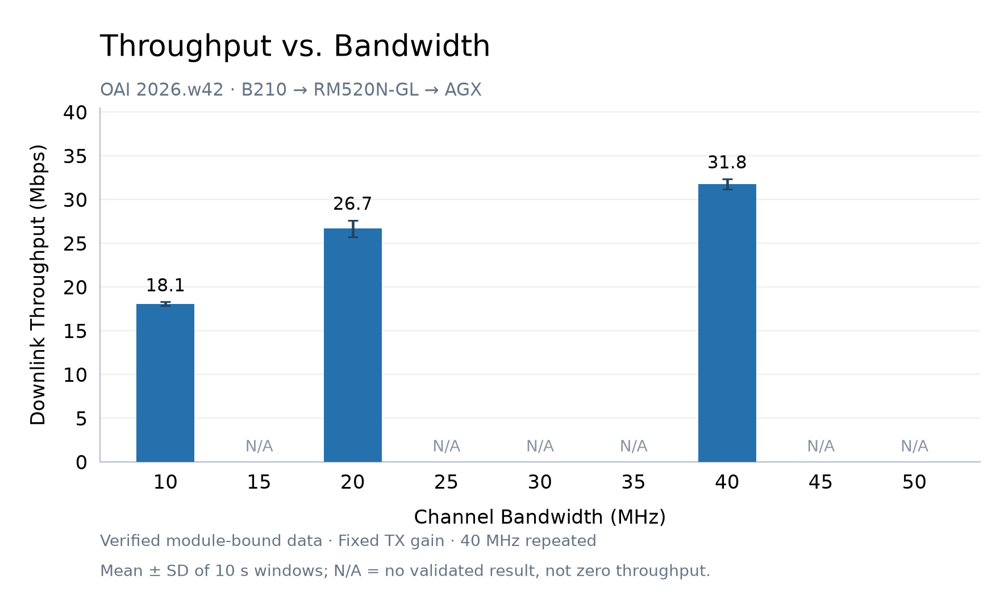

# 新版 OAI 的 10–50 MHz 实测

2026-10-20，在固定的 OAI `2026.w42` 官方镜像上，每隔 5 MHz 尝试一个档位。
全程使用原有核心网和 SIM、同一载频、原有 TDD、1 TX / 1 RX 与相同发射增益；没有应用源码补丁。

| Channel bandwidth | Result |
|---|---|
| 10 MHz / 24 PRB | 18.09 ± 0.24 Mbps |
| 15 MHz / 38 PRB | 启动失败：`N_RB 38 not yet supported for numerology 1` |
| 20 MHz / 51 PRB | 26.69 ± 0.96 Mbps |
| 25 MHz / 65 PRB | 启动失败：`N_RB 65 not yet supported for numerology 1` |
| 30 MHz / 78 PRB | 启动失败：`N_RB 78 not yet supported for numerology 1` |
| 35 MHz / 92 PRB | gNB 启动，等待 90 秒无有效模块数据 |
| 40 MHz / 106 PRB | 31.79 ± 0.59 Mbps，汇总前后两次通过的测量 |
| 45 MHz / 119 PRB | gNB 启动，等待 90 秒无有效模块数据；射频滤波器仍是 40 MHz |
| 50 MHz / 133 PRB | 启动失败：`unknown sampling rate 61440000` |

每次有效下载持续 35 秒，去掉前 5 秒，取三个约 10 秒窗口。
误差为时间窗口的样本标准差，不是独立实验的置信区间。
40 MHz 前后两次均值为 31.70 / 31.89 Mbps，相差约 0.60%。
这是本次单连接应用层接收吞吐，不是设备峰值能力，也不宜直接与其他时刻的旧版结果做性能结论。

AGX 数据 socket 绑定 RM520N-GL USB 网卡，管理报告走 Wi-Fi。
只有逐帧负载与序号校验通过的数据才计入接收字节，所有有效测量的校验错误均为 0。
原始配置、运行日志和帧采样保留在主机状态目录 `~/oai-gnb-next/bandwidth-sweep-20261020/`，不上传公开仓库。

10 MHz 的 OFDM 载波实际为 24 PRB，采样率 15.36 MS/s，启动时去掉 `-E`；
B210 驱动将模拟滤波器设为 20 MHz。较宽的模拟滤波器不会把 NR 载波变为 20 MHz。
20 MHz 使用 51 PRB、`-E`，CORESET0 索引 11；40 MHz 保持原配置。

此前仅根据通用采样率映射建议测试 35 / 45 MHz，需要纠正：
[3GPP TS 38.101-1 表 5.3.5-1](https://www.etsi.org/deliver/etsi_TS/138100_138199/13810101/18.05.00_60/ts_13810101v180500p.pdf#page=61)
并未将它们列为 n78 的 UE 信道带宽。源码有对应采样率分支不等于该频段的商用 UE 支持。
这两次未接通记录不能证明 UE 的峰值能力，也不能单独确定所有故障原因。

不兼容档位试验后，首次 40 MHz 自动回连也超时。通过现有 AT 接口发现模块处于其他 PLMN 的
受限服务状态，保留原有手动选网模式，以 `AT+COPS=1,2,"00101"` 重新选择实验 PLMN，
确认 `AT+C5GREG?` 返回已注册，再完成上表中的第二次有效 40 MHz 测量。
这一处理没有更改 SIM、模块固件或核心网配置。

最终恢复原来的新版 40 MHz 容器、正常增益，验证配置文件哈希未变化、核心网容器未重启、
新的模块绑定下载持续成功，并取消了独立恢复定时器。未验证档位记为 N/A，不当作 0 Mbps。

[汇总 CSV](bandwidth-throughput.csv) · [逐次 CSV](individual-runs.csv) · [脱敏验证记录](results.json) · [详细方法](METHODS.txt)
